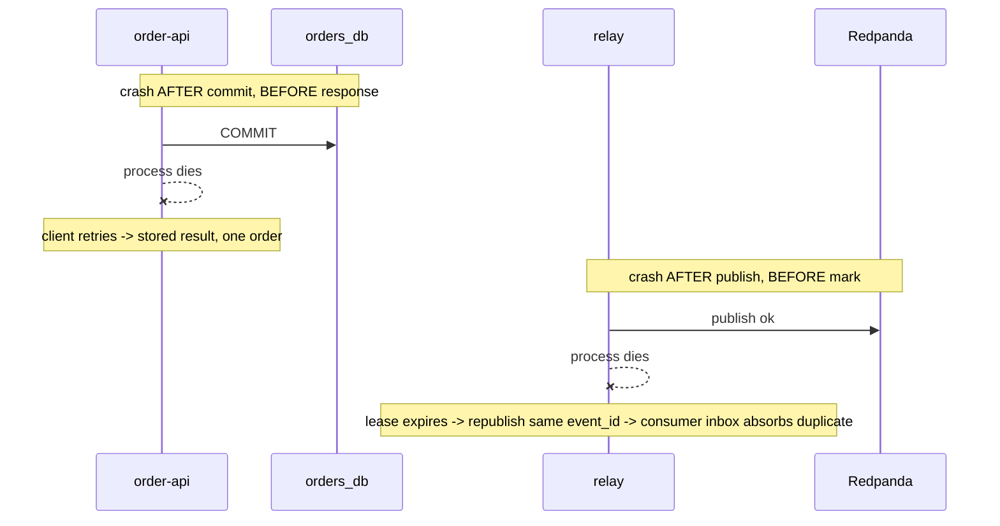

# Architecture

## 1. Components

One Spring Boot image runs in four roles, selected by `SPRING_PROFILES_ACTIVE`.

| Component | Profile | Owns |
|---|---|---|
| order-api | `api` | Idempotency filter, `orders`, `idempotency_records`, `outbox_events`; database `orders_db` |
| relay | `relay` | Reads unpublished outbox rows, publishes to Redpanda |
| inventory-consumer | `consumer` | Consumes `order.created`, reserves stock; database `inventory_db` |
| cli | `cli` | `verify` and `replay` commands |
| mock-payment (optional, M6b) | `payment` | Fake provider with its own idempotency key and a flaky mode |

Infrastructure: PostgreSQL (two databases in one instance), Redpanda, and an opt-in `obs` Compose profile with Prometheus, Grafana and Jaeger. Prometheus scrapes the API, relay and consumer management ports. Kafka observations and OTLP traces are exported to Jaeger when `OTLP_TRACING_EXPORT_ENABLED=true`; the default core stack keeps trace export disabled.

The producer and the consumer use separate databases. A shared database would let the consumer join the producer's transaction and hide the real distributed boundary.

The Compose consumer uses the `consumer` profile and a dedicated `latchkey_consumer` database role. A small bootstrap service creates or updates that role on every stack start, including when the PostgreSQL volume already exists. Development stock seeding is insert-only, so restarting the stack does not reset stock.

## 2. Request flow (Mode A)

```mermaid
sequenceDiagram
  participant C as Client
  participant A as order-api
  participant P as orders_db
  participant R as relay
  participant K as Redpanda
  participant N as consumer
  participant I as inventory_db
  C->>A: POST /v1/orders + Idempotency-Key
  A->>A: auth, validate key/body, payload_hash
  A->>P: BEGIN; INSERT idempotency_records ON CONFLICT DO NOTHING
  alt inserted
    A->>P: INSERT order + outbox row (event_id, version, traceparent); mark COMPLETED; COMMIT
    A-->>C: 201 + Location
  else conflict
    A->>P: SELECT stored record
    alt same hash
      A-->>C: stored result + Idempotent-Replayed
    else different hash
      A-->>C: 422
    end
  end
  R->>P: claim rows (FOR UPDATE SKIP LOCKED, lease)
  R->>K: publish (key = aggregate_id, acks=all)
  R->>P: set published_at
  K->>N: poll
  N->>I: BEGIN; INSERT inbox ON CONFLICT DO NOTHING
  alt new event
    N->>I: UPDATE stock; INSERT ledger; COMMIT
  else duplicate
    N->>I: COMMIT (no-op)
  end
  N->>K: commit offset
```

## 3. Crash points



## 4. Retry, backoff, DLQ, replay

**Consumer.**
1. Transient error (timeout, deadlock): do not commit the offset; retry in process with exponential backoff and full jitter (start 100 ms, cap 10 s, at most 5 tries), then pause the partition briefly rather than spin.
2. Poison message (undecodable, unknown `schema_version`, hash mismatch for a known `event_id`): insert the raw message into `dead_letters`, commit that transaction, then commit the offset. If the process dies between the two, redelivery may create a second DLQ row; this is harmless.
3. Replay: the CLI `replay --dlq-id=N [--dry-run]` requires `LATCHKEY_REPLAY_KEY` to match `LATCHKEY_ADMIN_KEY`, prints what it would do, writes an audit log line and republishes the saved key, payload and headers. The original `event_id` is preserved, so the inbox still protects against repeated effects. Export `LATCHKEY_ADMIN_KEY` from `.env` as `LATCHKEY_REPLAY_KEY`, then run `docker compose run --rm --no-deps -e SPRING_PROFILES_ACTIVE=cli -e LATCHKEY_ADMIN_KEY -e LATCHKEY_REPLAY_KEY consumer replay --dlq-id=N --dry-run`.

**Relay.** On publish error: `next_attempt_at = now() + backoff(attempts)`, record `last_error`. Alert on `oldest_unpublished_age`.

**Schema versioning.** Events carry `schema_version`; consumers accept known versions and DLQ unknown ones.

## 5. Memory budget

Target machine: about 6 GiB free RAM. JVM flags for every app container: `-XX:+UseSerialGC -XX:MaxRAMPercentage=70 -Xss512k`. Lazy bean initialisation is not used: it can defer the Flyway migration and the seeder past startup, and a service must fail at boot, not on its first request.

| Service | Memory limit |
|---|---|
| PostgreSQL | 512 MiB |
| Redpanda (`--smp 1 --memory 768M --overprovisioned --reserve-memory 0M`) | 1 GiB |
| order-api | 320 MiB |
| relay | 256 MiB |
| consumer | 256 MiB |
| Core total | about 2.3 GiB |
| Prometheus, Grafana, Jaeger (`obs` profile) | about 256 MiB each |

Limits are starting points; real usage is recorded in the report.

## 6. Services explained

The full explanation of every service (what it is, why chosen, configuration) is in `services.md`, written alongside the code in M7.
