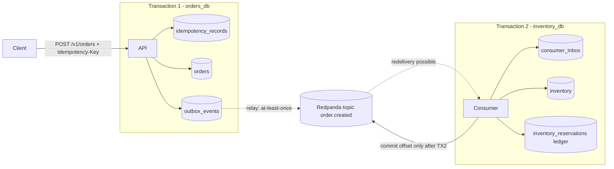
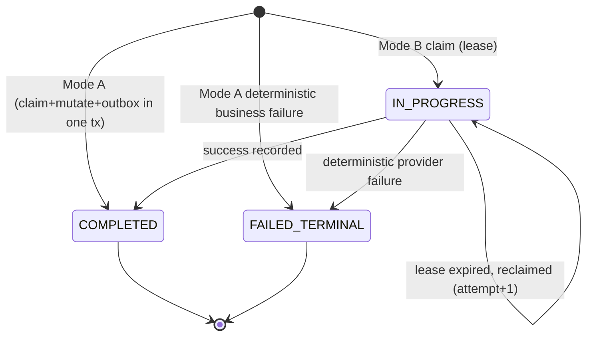

# Guarantees and non-guarantees

## What Latchkey guarantees

Inside a defined boundary, a business operation takes effect once, even when clients retry and messages are redelivered.

1. **Idempotent command.** A request with the same `(tenant, operation, Idempotency-Key)` and the same body creates at most one order. A retry returns the stored status and body with `Idempotent-Replayed: true`.
2. **Atomic claim.** The idempotency record, the order and the outbox row commit in one PostgreSQL transaction (Mode A). Either all exist or none.
3. **No lost events.** Every committed order has an outbox row, and every outbox row is eventually published (at-least-once publish).
4. **Effectively-once consumption.** The consumer records the event in its inbox, changes stock and writes the effect-ledger row in one transaction, and commits the Kafka offset only after that transaction commits. A redelivered event is a no-op.
5. **Ordering.** Events for one aggregate keep order within a partition (key = `aggregate_id`, with `aggregate_version`). There is no global order.
6. **Tenant isolation.** The tenant is derived from the credential. One tenant cannot read or collide with another's keys.

The phrase "effectively once" is used only with this boundary: at-least-once delivery + durable deduplication + atomic state change.

## What Latchkey does not guarantee

- **No universal exactly-once.** The broker can deliver a message twice; the inbox makes the effect idempotent.
- **No external effects** (payment, email) are exactly-once unless the provider honours an idempotency key (Mode B, M6b).
- **No high availability.** One broker and one PostgreSQL instance. A broker or DB outage stops progress; nothing is lost, and the system drains after recovery.
- **No global ordering** across aggregates or partitions.
- **No TLS** in the local Compose setup. Production would terminate TLS in front of the API.
- **Idempotency keys expire.** A retry after `expires_at` is treated as a new request.
- **Clock skew is not a concern for timing logic**, because all lease and expiry times use the database clock (`now()`), never application clocks.

## Boundary diagram

Solid arrows are inside a database transaction (atomic). Dotted arrows cross a process or network boundary (can repeat, so the receiving side deduplicates).

## Mode A and Mode B

**Mode A (local only).** The claim, the state change and the outbox write happen in one transaction. A concurrent duplicate blocks on the unique index until the first transaction commits or rolls back, bounded by `lock_timeout`. Because nothing is committed until the whole transaction finishes, no `IN_PROGRESS` row ever exists. After the first commit, the duplicate reads the committed result.

**Mode B (external side effect).** An external call cannot be inside a database transaction. So the claim is committed first as `IN_PROGRESS` with a lease (`lease_expires_at`), the external call is made outside any transaction using a provider idempotency key derived from `operation_id`, and the result is recorded in a second transaction. A retry that finds a live lease gets 409 + `Retry-After`. A retry that finds an expired lease reclaims it with a compare-and-set update and re-executes with the same provider key.

Mode B is needed only when the operation calls something outside PostgreSQL.

## State machine

Terminal states are never mutated.

## Failure modes

| Failure | Result |
|---|---|
| Crash before commit | Nothing persisted; the retry succeeds |
| Crash after commit, before response | The retry returns the stored result; one order |
| Relay publishes, then dies before marking | Duplicate message; one consumer effect |
| Relay dies mid-batch | Leases expire; another relay finishes the batch |
| Broker down | Outbox age grows; drains after recovery |
| Consumer dies after DB commit, before ack | Redelivery is a no-op |
| Poison message | Row in `dead_letters`; partition keeps moving |
| DB unavailable | API returns 503; never answered from cache |
